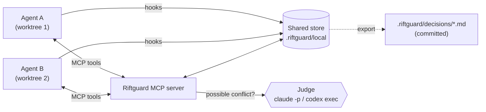

<div align="center">

# Riftguard

**Keep parallel AI coding agents from silently contradicting each other.**

[](https://github.com/B4K2/Riftguard/actions/workflows/ci.yml)
[](https://pypi.org/project/riftguard/)
[](https://pypi.org/project/riftguard/)
[](LICENSE)

Works with **Claude Code** and **Codex** · No API keys · Sits beside git, not instead of it

</div>

---

Run two coding agents on one repo and they will happily make opposite architectural choices.
Agent A builds around **Postgres**, agent B builds around **MongoDB**, the code merges cleanly,
and you find out the system is incoherent at review time. Git can't catch it: the conflict is in
the *ideas*, not the lines.

Riftguard gives your agents a shared memory of decisions and a judge to check new ones against
it, so **the second agent is told before it writes any code**.

```text
agent B ▸ record_decision("datastore", "MongoDB", "flexible schema")

HELD FOR REVIEW: #4 [datastore] MongoDB conflicts with #3 [database] Postgres by agent-a
(reason: relational data, need transactions) (severity high, confidence 0.95, judge: claude).
Judge: Keep Postgres (#3); transactions are a hard requirement, and JSONB covers flexible schemas.
Do not build on MongoDB. Follow the existing decision, or wait for the developer to run
`riftguard resolve 4 --keep <id>`.
```

## Features

- **Shared decisions:** agents call `check_decisions` before architectural choices and
  `record_decision` after. Every worktree sees the same decisions immediately.
- **Conflict judge:** a fresh, tool-less `claude -p` or `codex exec` session decides whether
  two decisions really clash. Postgres vs MongoDB is a conflict; Postgres plus a Redis cache is
  not. Confirmed conflicts are held until you resolve them.
- **Trajectory recording:** hooks record every tool call into a content-addressed store, with
  each step linked to its parent like a git commit. You don't need to change the agent at all.
- **Automatic checkpoints:** every call is tagged `pure`, `reversible` or `irreversible`, and
  a checkpoint is saved just before anything that can't be undone.
- **Zero setup secrets:** the judge runs on the agent CLI you're already logged into.

## Quick start

```bash
uv tool install riftguard          # or: pipx install riftguard
cd your-repo
riftguard init                     # wires up Claude Code and/or Codex, whichever is installed
```

Then restart your agent in the repo. That's it: agents now check and record decisions on their
own, and you review conflicts with:

```bash
riftguard conflicts                # what's held, the judge's verdict and rationale
riftguard resolve 4 --keep 3       # keep #3 and reject #4 (or --keep 4 to replace #3)
```

<details>
<summary><b>What does <code>init</code> change?</b></summary>

| Agent | Files |
|-------|-------|
| Claude Code | hooks in `.claude/settings.json`, MCP server in `.mcp.json`, instructions in `CLAUDE.md` |
| Codex | MCP server and hooks in `.codex/config.toml`, instructions in `AGENTS.md` |
| Both | `.riftguard/config.toml` and `.riftguard/decisions/` (commit these); `.riftguard/local/` (gitignored) |

Choose explicitly with `--harness claude|codex|both`. Codex only loads project config for
trusted projects and asks you to approve new hooks (`/hooks`) on first run. Re-running `init` is
safe: it updates its own sections and leaves the rest of your config alone.

</details>

## How it works



1. **Hooks** (`PreToolUse` / `PostToolUse`) record each tool call. They never print to the
   agent, so recording costs zero tokens.
2. **One store per repo.** Every git worktree resolves to the main repo's SQLite store, so a
   decision made in one worktree is visible in all of them right away, without waiting for a merge.
3. **The MCP server** exposes `check_decisions`, `record_decision`, `get_decision` and
   `checkpoint`. Replies stay compact: only matching decisions are shown in full.
4. **The judge** runs only when a new decision's topic matches another agent's. It sees only the
   decisions, never the requesting agent's conversation, so the agent that wants the change
   isn't the one judging it. If the CLI is missing or fails, a keyword heuristic takes over so
   agents are never blocked.

## Configuration

`.riftguard/config.toml` (committed):

```toml
[judge]
backend = "auto"   # auto (claude, else codex, else heuristic) | claude | codex | heuristic
model = ""         # e.g. "haiku"
```

`RIFTGUARD_JUDGE_BACKEND` overrides the backend for one shell.

## Commands

| Command | What it does |
|---------|--------------|
| `riftguard init [--harness ...]` | Set up the repo for Claude Code and/or Codex |
| `riftguard decisions [--all]` | Active (or all) decisions |
| `riftguard decide <topic> <choice> -r <reason>` | Record a decision yourself (never held for review) |
| `riftguard conflicts` | Decisions held for review |
| `riftguard resolve <id> --keep <id>` | Settle a conflict |
| `riftguard supersede <id>` | Retire a decision |
| `riftguard status` | Agents, worktrees, step counts, last activity |
| `riftguard log [-a agent] [-t tool]` | Recorded steps, newest first |
| `riftguard show <hash>` | One step's full input and output |
| `riftguard checkpoint <label>` | Name an agent's current step |
| `riftguard checkpoints [--no-auto]` | List checkpoints |

## Limitations

- One agent per worktree: the MCP server identifies the caller by its worktree.
- The judge only sees decisions whose topics match by keyword or synonym, so very differently
  worded topics can slip past it.
- Shell commands outside a read-only allowlist count as `irreversible`, which is deliberately
  cautious.
- The Codex integration follows the Codex docs and is tested against a stand-in binary.

## Related work

**AgentGit** (Li et al., 2025, [arXiv:2511.00628](https://arxiv.org/abs/2511.00628)) adds
Git-like commit, revert and branching to the state of a single LangGraph multi-agent workflow,
mainly so pipelines can roll back or explore prompt variants without recomputing shared steps.
Riftguard instead coordinates *independent* coding agents (unmodified Claude Code and Codex
sessions, via hooks and MCP) working in parallel git worktrees: shared architectural decisions,
conflict judging between agents, and explicit side-effect classes. Riftguard's automatic
checkpoints are adapted from that paper.

## Development

```bash
git clone https://github.com/B4K2/Riftguard && cd Riftguard
uv sync
uv run pytest
uv run riftguard init   # in a dev venv, init pins this venv's interpreter path in the configs
```

**Releasing:** bump `version` in `pyproject.toml`, commit, then tag. CI runs the tests on Python
3.11–3.13, checks the tag matches the version, publishes to PyPI and creates a GitHub release.

```bash
uv version --bump patch            # 0.1.0 -> 0.1.1
git commit -am "Release v$(uv version --short)"
git tag "v$(uv version --short)" && git push origin main --tags
```

## License

[MIT](LICENSE)
